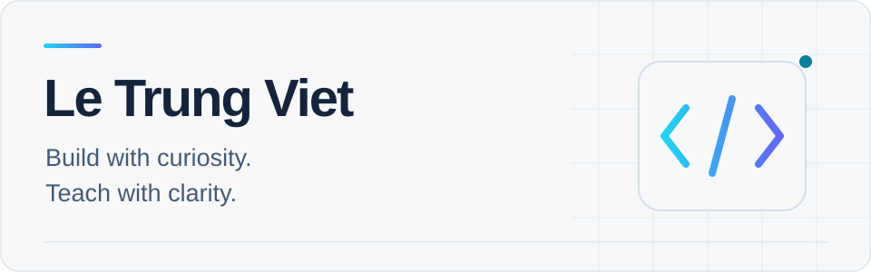
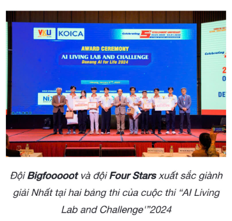
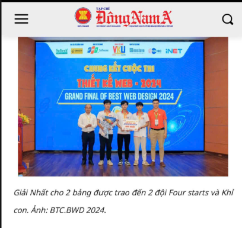

<picture>
  <source media="(prefers-color-scheme: dark)" srcset="assets/branding/banner-dark.svg">
  <source media="(prefers-color-scheme: light)" srcset="assets/branding/banner-light.svg">
  
</picture>

# Le Trung Viet

**Full Stack Developer · Python Instructor · AI Enthusiast**

I build web applications and teach Python, helping learners turn ideas into clear, practical code. I'm a fourth-year Software Engineering student at **Vietnam-Korea University of Information and Communication Technology (VKU)**, exploring AI, machine learning, and IoT.

[Facebook](https://www.facebook.com/profile.php?id=100027748189490) · [Instagram](https://instagram.com/viet_lee05)

## What I Do

- **Build** — Develop full stack web applications, from user interfaces to backend services.
- **Teach** — Help Python learners develop programming fundamentals and problem-solving skills.
- **Explore** — Investigate practical applications of AI and IoT.

Currently learning **System Design**, **Cloud Computing**, and **Computer Vision**.

## Selected Projects

### [GoPitch · Backend](https://github.com/letrungviet2005/GoPitch-BE)

An API for a football pitch booking platform, covering club discovery, scheduling, bookings, and payments.

**Java · Spring Boot · MySQL**

### [Fall Detection](https://github.com/letrungviet2005/Fall-detection)

A video analysis project that combines person detection, pose analysis, and motion tracking to identify possible falls.

**Python · OpenCV · NumPy**

## Tech Stack

**Python** for teaching and exploration · **React** for interfaces · **Spring Boot** for backend development

- **Languages:** Python, Java, JavaScript, TypeScript, C++, PHP
- **Frontend:** React, HTML, CSS, Tailwind CSS, Bootstrap, Vite
- **Backend:** Spring Boot, Node.js, Laravel
- **Database & tools:** MySQL, Git, GitHub, Docker, Postman
- **Platforms:** Vercel, Cloudflare, Google Cloud

## GitHub Activity

  

[Explore my repositories](https://github.com/letrungviet2005?tab=repositories) and follow what I'm building.

<!-- GALLERY:START -->

## Achievements & Moments

A few moments from my learning journey.

  
   award1

  
   award2

<!-- GALLERY:END -->

## Connect

Let's talk about building useful software, learning Python, or exploring AI together. Reach me on [Facebook](https://www.facebook.com/profile.php?id=100027748189490) or [Instagram](https://instagram.com/viet_lee05).
