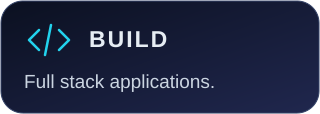
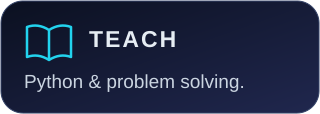
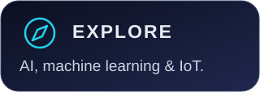
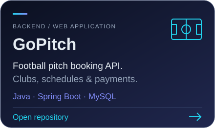
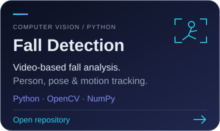

<picture>
  <source media="(max-width: 600px)" srcset="assets/branding/banner-mobile.svg">
  <source media="(prefers-color-scheme: dark)" srcset="assets/branding/banner-dark.svg">
  
</picture>

<h1 align="center">Build with curiosity. Teach with clarity.</h1>

I'm <strong>Le Trung Viet</strong>, a fourth-year Software Engineering student at <strong>Vietnam-Korea University of Information and Communication Technology (VKU)</strong>. 
I build full stack applications and teach Python, helping learners turn ideas into clear, practical code. 
I explore AI, machine learning, and IoT.

  
  
  

  
  
  

Currently learning · <strong>System Design / Cloud Computing / Computer Vision</strong>

## Selected Projects

  
  

**[GoPitch · Backend ↗](https://github.com/letrungviet2005/GoPitch-BE)** — A football pitch booking API for club discovery, scheduling, bookings, and payments. Java · Spring Boot · MySQL.

**[Fall Detection ↗](https://github.com/letrungviet2005/Fall-detection)** — Video analysis combining person detection, pose analysis, and motion tracking to identify possible falls. Python · OpenCV · NumPy.

## Tech Stack

<strong>CORE / Python · React · Spring Boot</strong>

Teach &amp; explore · Build interfaces · Develop APIs

**Languages** 

**Frontend** 

**Backend** 

**Database & Tools** 

**Platforms** 

## GitHub Activity

  

<a href="https://github.com/letrungviet2005?tab=overview">View live activity ↗</a> · <a href="https://github.com/letrungviet2005?tab=repositories">Explore repositories ↗</a>

<!-- GALLERY:START -->

## Achievements & Moments

A few moments from my learning journey.

<table>
<tr>
<td align="center" width="50%">
  
</td>
<td align="center" width="50%">
  
</td>
</tr>
</table>

<!-- GALLERY:END -->

## Connect

Let's talk about building useful software, learning Python, or exploring AI together. Reach me on [Facebook](https://www.facebook.com/profile.php?id=100027748189490) or [Instagram](https://instagram.com/viet_lee05).
